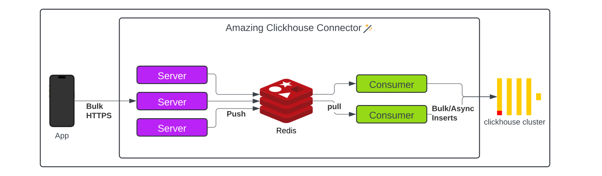

# Amazing clickhouse connector
[](https://vshymanskyy.github.io/StandWithUkraine/)

Tools for receiving metrics from clients through https as json objects, putting them in Redis queue, and finally into ClickHouse.

Built to withstand high throughput by design and for running in Kubernetes.



## Features:
* Multi-thread batching
* Async inserts
* Prometheus monitoring out of the box
* Process table alters automatically if event arrives with new column
* Based on event type filed can put different events it into the corresponding table

## Hot to use it?

Application works in two modes:

server - mode when the app receives metrics and put them into redis queue

consumer - mode when the app consumes redis queue and writes metrics into clickhouse

You can run both with docker-compose and then send events to `/api/v1/s2s/event` endpoint with the `x-auth-token` header.
One request must contain at least one well-formed json object.
It is also possible to set custom event_type. In this case event will store into corresponding to event_type table ( default by default ).

## Arguments

| Argument                      | Value                                 | Default                 |
| ------------------------------| ---------------                       | ----------------------- |
| \-mode                        | server/consumer                       | \--                     |
| \-threads                     | int                                   | 10                      |
| \-listen-address              | ip:port                               | :6000                   |
| \-prometheus-listen-address   | ip:port                               | :6001                   |
| \-redisServer                 | ip:port                               | 127.0.0.1:6379          |
| \-clickhouseServer            | ip:port                               | 127.0.0.1:9000          |
| \-clickhouseBatchSize         | int                                   | 1000                    |
| \-clickhouseBatchTimeout      | int                                   | 300                     |
| \-clickhouseAsyncMode         | bool                                  | false                   |
| \-clickhouseUsername          | string                                | default                 |
| \-clickhousePassword          | string                                | \--                     |
| \-clickhouseTLS               | bool                                  | false                   |
| \-clickhouseTLSSkipVerify     | bool                                  | false                   |
| \-clickhouseClusterName       | string                                | test_cluster_two_shards |
| \-clickhouseLegacyDistPrefix  | bool                                  | false                   |
| \-clickhouseDatabaseName      | string                                | default                 |
| \-columnTypesConfig           | json `{"column_name":"column_type"}`  | \--                     |
| \-maxBodyBytes                | int                                   | 1048576                 |
| \-maxColumns                  | int                                   | 1000                    |

Secrets are read from environment variables so they never appear in the pod spec or process list
(the matching flags still exist but should not be used in Kubernetes):

| Env var               | Mode            | Meaning                                                                 |
|-----------------------|-----------------|-------------------------------------------------------------------------|
| `AUTH_KEY`            | server          | Required. Comma-separated accepted `x-auth-token` values (min 16 chars) |
| `CLICKHOUSE_PASSWORD` | consumer        | ClickHouse password                                                     |
| `REDIS_PASSWORD`      | server/consumer | Redis password                                                          |

In Helm these come from the `<release>-secrets` Secret. Pass `config.authKey` (and optionally
`config.authKeyPrevious` to accept the old key during a rotation) at deploy time with `--set-string`.

Event names (`event_type`) and field names must match `^[A-Za-z_][A-Za-z0-9_]*$` (max 200 chars).
Events that don't are dropped by the consumer.

## How to run it locally?

#### Up local test environment

`docker compose up -d --build`

The environment runs the server, one consumer, a single ClickHouse instance and Valkey. Ports are bound to
`127.0.0.1`. For cluster mode (`-clickhouseClusterName`) point the consumer at your own ClickHouse cluster.

#### Generate events

`while true; cat tests/many_jsons.txt | curl -H 'x-auth-token:local-dev-auth-key-only' http://127.0.0.1:6000/api/v1/s2s/event --data-binary @-; end`

#### Check queue size

`docker compose exec redis valkey-cli LLEN "rmq::queue::[clickhouse_connector]::ready"`

#### Check inserts amount

`docker compose exec clickhouse clickhouse-client --user connector --password local-dev-password-only --query "select COUNT(*) from clickhouse_connector.response_time_base_api"`

ℹ️ Run next command for resolving dependency issue if you install dev environment from scratch:\
`go get -u github.com/ClickHouse/clickhouse-go/v2`\
`go get -u github.com/adjust/rmq/v5`

## Configuration notes

### Single ClickHouse Instance Support

The connector now supports both ClickHouse clusters and single ClickHouse instances. The mode is automatically detected based on the `clickhouseClusterName` parameter:

- **Cluster mode**: When `clickhouseClusterName` is specified (non-empty), the connector uses:
  - `ReplicatedReplacingMergeTree()` engine for base tables
  - `Distributed` tables for data distribution across cluster nodes
  - `ON CLUSTER` clause in DDL statements

- **Single instance mode**: When `clickhouseClusterName` is empty or not specified, the connector uses:
  - `ReplacingMergeTree()` engine (no replication needed)
  - No Distributed tables are created
  - No `ON CLUSTER` clause in DDL statements

To use single ClickHouse instance, simply set `clickhouseClusterName` to an empty string in your configuration.

### TLS connection

Set `clickhouseTLS` to `true` to connect over TLS. This is required by managed offerings such as
ClickHouse Cloud (native protocol port `9440`).

- Certificates are verified against the system trust store by default, using the host part of
  `clickhouseServer` as the TLS server name (SNI).
- The minimum negotiated protocol version is TLS 1.2.
- `clickhouseTLSSkipVerify` disables certificate verification. It is insecure and intended for local
  testing only — do not enable it in production.

### Legacy `dist_` table prefix (cluster → ClickHouse Cloud migration)

When a ClickHouse cluster is migrated to a single instance (e.g. ClickHouse Cloud), the historical
`dist_` Distributed tables become plain tables, but existing queries and dashboards still read from
`dist_<table>`. To keep them working, enable the legacy prefix mode:

- Set `clickhouseLegacyDistPrefix` to `true` **and** run in single instance mode (`clickhouseClusterName` empty).

In this mode the connector creates, alters and writes data to physical tables named `dist_<event_type>`
(as `ReplacingMergeTree()`), so no downstream query changes are needed after migration.

The flag has no effect in cluster mode: there the base tables and their `dist_` Distributed tables are
still managed as before.

## Tests

- `go test ./...` runs the unit tests.
- `tests/helm_test.sh` lints and renders the Helm chart and checks the security-relevant output (needs `helm`).
- `e2e/` deploys the chart with a real ClickHouse into a [kind](https://kind.sigs.k8s.io/) cluster and checks the
  whole path: authentication and request limits, events reaching ClickHouse, table creation and alteration,
  dropping of unsafe names, queue buffering while the consumer is down, Valkey ACL and NetworkPolicy, pod
  hardening and metrics. It needs `docker`, `kind` and `helm`:

  ```shell
  cd e2e && go test -tags e2e -count=1 -timeout 25m ./...
  ```

  Set `E2E_KEEP_CLUSTER=1` to keep the cluster for debugging, `E2E_CLUSTER_NAME` to change its name and
  `E2E_LOGS_DIR` to export the cluster logs.

See [CHANGELOG.md](CHANGELOG.md) for the release history.
